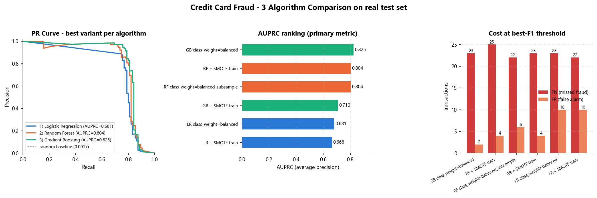
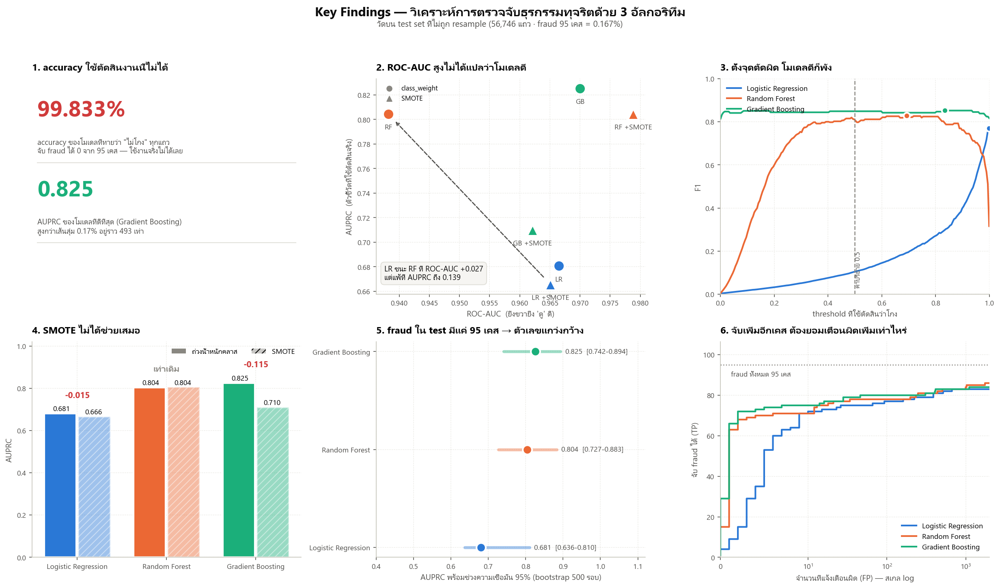

# สรุปผลการวิเคราะห์ด้วย 3 อัลกอริทึม (Analyze)

> ไฟล์นี้ถูกสร้างใหม่อัตโนมัติทุกครั้งที่รัน `python analyze/compare_all.py`

## ทำอะไรไป

ต่อยอดจาก pre-processing pipeline (`python main.py`) และผลคัดฟีเจอร์ใน `feature/`
โดยนำชุดข้อมูลที่ประมวลผลแล้วใน `outputs/processed.npz` ไปเทรนและวัดผล
ด้วยอัลกอริทึมจำแนก 3 ตระกูล เพื่อตอบวัตถุประสงค์ใน `Introduction.txt`
คือจำแนกธุรกรรมทุจริต และประเมินด้วย **AUPRC** (ไม่ใช่ accuracy)

| # | อัลกอริทึม | ตระกูลโมเดล | โฟลเดอร์ |
|---|-----------|------------|---------|
| 1 | Logistic Regression | linear model | `analyze/logistic_regression/` |
| 2 | Random Forest | bagging ensemble | `analyze/random_forest/` |
| 3 | Histogram Gradient Boosting | boosting ensemble | `analyze/gradient_boosting/` |

ทุกอัลกอริทึมเทียบ 2 วิธีจัดการ imbalance บนข้อมูลชุดเดียวกัน
คือ **ถ่วงน้ำหนักคลาส** (`class_weight`) กับ **SMOTE บน train** รวมเป็น 6 แบบ

## ทำอย่างไร

- ข้อมูล: train 226,980 แถว / test 56,746 แถว (fraud 95 เคส = 0.1674%)
- test set **ไม่ถูก resample** คงการกระจายจริงไว้ ตามกฎใน `AGENTS.md`
- ไม่มี data leakage: เทรนบน train เท่านั้น แล้ว predict ลง test
- `random_state=42` ทุกโมเดล รันซ้ำได้ผลเดิม
- วัดผล 2 จุด: ที่ threshold 0.5 (ค่าปริยาย) และที่ threshold ซึ่งให้ F1 สูงสุด
  หาจาก PR curve เต็มเส้น เพราะโมเดลที่ถ่วงน้ำหนักคลาสดันคะแนนไปกองใกล้ 1
  ทำให้ threshold 0.5 ให้ false positive เยอะเกินใช้งานจริง

## ผลลัพธ์ (เรียงตาม AUPRC)

| อันดับ | แบบ | AUPRC | ROC-AUC | Recall@0.5 | Precision@0.5 | F1 ดีที่สุด | Recall ที่จุดนั้น | Precision ที่จุดนั้น | FN | FP |
|---|---|---|---|---|---|---|---|---|---|---|
| 1 | GB class_weight=balanced | **0.8252** | 0.9700 | 0.7684 | 0.9481 | 0.8521 | 0.7579 | 0.9730 | 23 | 2 |
| 2 | RF + SMOTE train | **0.8045** | 0.9788 | 0.7684 | 0.8588 | 0.8284 | 0.7368 | 0.9459 | 25 | 4 |
| 3 | RF class_weight=balanced_subsample | **0.8043** | 0.9382 | 0.7263 | 0.9324 | 0.8391 | 0.7684 | 0.9241 | 22 | 6 |
| 4 | GB + SMOTE train | **0.7100** | 0.9621 | 0.7684 | 0.8588 | 0.8421 | 0.7579 | 0.9474 | 23 | 4 |
| 5 | LR class_weight=balanced | **0.6806** | 0.9665 | 0.8737 | 0.0557 | 0.8136 | 0.7579 | 0.8780 | 23 | 10 |
| 6 | LR + SMOTE train | **0.6656** | 0.9651 | 0.8632 | 0.1076 | 0.8202 | 0.7684 | 0.8795 | 22 | 10 |

**ดีที่สุดตาม AUPRC: GB class_weight=balanced** (AUPRC = 0.8252) — ที่จุด F1 ดีที่สุดจับ fraud ได้ 75.8% โดยพลาด 23 เคส และแจ้งเตือนผิด 2 เคส



## Key Findings — ข้อค้นพบสำคัญ



> แผนภาพเต็ม: `analyze/key_findings.png` · ตัวเลขดิบ: `analyze/key_findings.json`

**1. accuracy ใช้ตัดสินงานนี้ไม่ได้** — โมเดลที่ทายว่า "ไม่โกง" ทุกแถว ได้ accuracy 99.833% ทั้งที่จับ fraud ไม่ได้สักเคสจาก 95 เคส จึงใช้ AUPRC เป็นตัวตัดสินตลอดทั้งงาน

**2. ROC-AUC สูงไม่ได้แปลว่าโมเดลดี** — LR (LR + SMOTE train) มี ROC-AUC สูงกว่า RF อยู่ 0.027 แต่ AUPRC ต่ำกว่าถึง 0.139 เพราะ ROC-AUC ถูกถ่วงด้วย true negative นับแสนแถวที่ทายง่ายอยู่แล้ว

**3. การตั้ง threshold สำคัญกว่าการเลือกวิธีแก้ imbalance** — ที่ค่าปริยาย 0.5 Logistic Regression ได้ F1 แค่ 0.105 แต่พอเลือกจุดตัดจาก PR curve ได้ถึง 0.820 (ช่อง 3 ของแผนภาพ: เส้นของ GB แบนราบ = ทนการตั้งจุดตัดผิด ส่วน LR เป็นยอดแหลม)

**4. SMOTE ไม่ได้ช่วยเสมอ** — ทำให้ Gradient Boosting แย่ลง 0.115 AUPRC (0.825 → 0.710) ขณะที่อีกสองตัวแทบไม่ต่าง การถ่วงน้ำหนักคลาสจึงเป็นค่าเริ่มต้นที่ปลอดภัยกว่า

**5. fraud ใน test มีแค่ 95 เคส ตัวเลขจึงแกว่งกว้าง** — AUPRC ของ Gradient Boosting = 0.825 แต่ช่วงความเชื่อมั่น 95% คือ 0.742–0.894 (bootstrap 500 รอบ) กว้างกว่าช่องว่างระหว่างอันดับ 1 กับ 2 เสียอีก

**6. ทุกจุดตัดคือการแลก** — fraud 1 เคสที่จับเพิ่มได้ ต้องจ่ายด้วยจำนวนแจ้งเตือนผิด ที่เพิ่มขึ้นเร็วมากในช่วงท้าย (ช่อง 6 แกน X เป็นสเกล log) การเลือกจุดตัดจึงเป็นการตัดสินใจเชิงธุรกิจ ไม่ใช่เรื่องที่โมเดลตอบให้ได้

## ข้อควรระวัง / สิ่งที่ต้องโฟกัสต่อ

1. **threshold ถูกเลือกบน test set เดียวกับที่วัดผล — ตัวเลขจึงดูดีเกินจริง** ทดสอบโดยเลือกจุดตัดจาก test ครึ่งแรกแล้วเอาไปใช้กับครึ่งหลัง: Gradient Boosting ได้ F1 = 0.804 เทียบกับ 0.825 ถ้ารู้คำตอบล่วงหน้า (ต่างกัน 0.020) **ถ้าจะใช้งานจริงต้องเลือก threshold จาก validation set แยก หรือ cross-validation บน train**
2. **อย่าฟันธงว่าอันดับ 1 ชนะอันดับ 2 จริง** — ช่วงความเชื่อมั่นของ Gradient Boosting (0.742–0.894) กับ Random Forest (0.727–0.883) **ซ้อนทับกันเกือบทั้งช่วง** ด้วย fraud แค่ 95 เคส ความต่างระดับ 0.02 ยังไม่พอสรุป
3. **ข้อมูลเป็นลำดับเวลา 2 วัน แต่ split แบบสุ่ม** — pipeline ใช้ stratified random split แปลว่าโมเดลได้เห็นธุรกรรม "อนาคต" ตอนเทรน ถ้าจะประเมินแบบใกล้ของจริง ควรแบ่งตามเวลา (เทรนวันแรก ทดสอบวันที่สอง) ซึ่งผลมักต่ำกว่านี้
4. **threshold ที่ดีที่สุดของ Logistic Regression อยู่ที่ 0.999999** ขยับนิดเดียวผลเปลี่ยนทันที (ดูยอดแหลมในช่อง 3) ถือว่าเปราะเกินกว่าจะเอาไปใช้งานจริง
5. **V1–V28 เป็นผลลัพธ์จาก PCA ตีความไม่ได้** — ถึงโมเดลจะชี้ว่า V14/V12/V10 สำคัญที่สุด ก็อธิบายลูกค้าหรือผู้ตรวจสอบไม่ได้ว่าทำไมธุรกรรมถึงถูกปฏิเสธ ถ้าต้องใช้จริงในธุรกิจต้องเตรียมวิธีอธิบายเพิ่ม
6. **ยังไม่ได้จูน hyperparameter** — ทุกโมเดลใช้ค่าที่ตั้งไว้ตายตัว ตัวเลขชุดนี้จึงเป็น baseline ที่เทียบกันได้อย่างเป็นธรรม ไม่ใช่เพดานของแต่ละอัลกอริทึม
7. **ถ้ารัน `python main.py` ใหม่ ต้องรัน `analyze/` ใหม่ทั้งหมด** เพราะทุกอย่างอิง `outputs/processed.npz` ของรอบนั้น ผลเก่าจะไม่ตรงกัน

## ไฟล์ผลลัพธ์

| ไฟล์ | เนื้อหา |
|------|---------|
| `analyze/comparison_all_models.csv` | ตารางเทียบทั้ง 6 แบบ |
| `analyze/comparison_summary.json` | สรุปเชิงโครงสร้าง + อันดับ AUPRC |
| `analyze/comparison_summary.png` | PR curve / อันดับ AUPRC / ต้นทุน FN-FP |
| `analyze/key_findings.png` | แผนภาพข้อค้นพบสำคัญ 6 ช่อง |
| `analyze/key_findings.json` | ตัวเลขหลังแผนภาพ (CI, threshold transfer, ผล SMOTE) |
| `analyze/<algo>/<p>_results.csv` | ผลของอัลกอริทึมนั้นแยก variant |
| `analyze/<algo>/<p>_thresholds.csv` | ตัวชี้วัดไล่ตาม threshold |
| `analyze/<algo>/<p>_summary.json` | พารามิเตอร์ + ตัวชี้วัดครบ |
| `analyze/<algo>/<p>_analysis.png` | PR curve + confusion matrix |
| `logs/analyze_progress.log` | log ว่า step ไหนเสร็จแล้ว (append ทุกรอบ) |

## รันต่อ / รันซ้ำ

```powershell
python analyze/logistic_regression/lr_analysis.py   # ~10 วินาที
python analyze/random_forest/rf_analysis.py         # ~85 วินาที (ช้าสุด)
python analyze/gradient_boosting/gb_analysis.py     # ~20 วินาที
python analyze/compare_all.py                       # ~2 วินาที (ไม่เทรนใหม่)
```

ถ้าปิดเครื่องกลางทาง เปิด `logs/analyze_progress.log` ดูว่าบรรทัดล่าสุด
ของแต่ละ ALGO เป็น `DONE` แล้วหรือยัง แล้วรันต่อเฉพาะตัวที่ยังไม่ `DONE`
(`compare_all.py` ต้องรันหลังสุด เพราะอ่านผลของทั้ง 3 ตัว)
